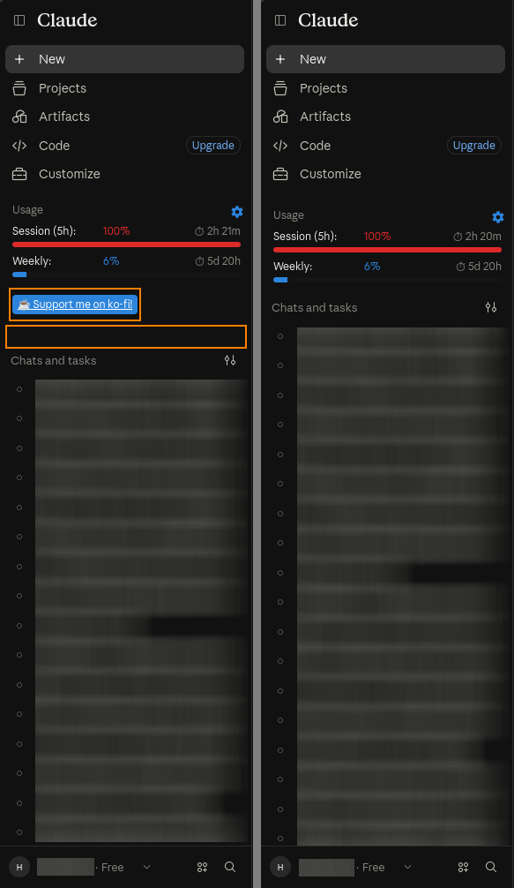

# Claude-Usage-Extension-Donate-Hideable

A tiny userscript for the [Claude Usage Extension][upstream] that hides
the ko-fi donate footer in the Claude.ai sidebar and keeps the
surrounding spacing symmetric.

[upstream]: https://github.com/lugia19/Claude-Usage-Extension

## Why this exists

The extension's sidebar has four footer links: desktop version, Claude
QoL, report a bug, and a ko-fi donate link. The first three can be
toggled off in the extension settings. [The fourth cannot](./docs/donate-button-undisableable.png) — the
maintainer has [confirmed][issue] that this is intentional, and that's a
fair call for the project.

For anyone who prefers a cleaner sidebar, though, that footer is just
noise. This userscript hides it, without touching the extension itself,
so users stay on the store version that keeps auto-updating.

[issue]: https://github.com/lugia19/Claude-Usage-Extension/issues/162

## Before / after

## Install

1. Install [Tampermonkey](https://www.tampermonkey.net/) or
   [Violentmonkey](https://violentmonkey.github.io/).
2. Open
   [`hide-donate-footer.user.js`](https://raw.githubusercontent.com/hopsayer/Claude-Usage-Extension-Donate-Hideable/main/hide-donate-footer.user.js)
   and confirm installation.

No configuration needed. The script runs on `https://claude.ai/*`.

## What it does

Two things, and the second one is the non-obvious part.

**1. Hides the donate footer.** Locates `.ut-sidebar-footer` elements
that contain a `ko-fi.com` link and sets `display: none !important`.

**2. Keeps the sidebar spacing symmetric.** This is why the script
can't be a pure-CSS rule.

The extension's own layout code computes whether any sidebar footer is
visible, and switches the container between two states:

- at least one footer visible → `mb-6` on the container, normal spacing;
- no footer visible → `pt-1.5` and `ut-no-footers`, compact spacing.

That check reads each footer's **inline** `style.display`. Hiding the
donate footer with a CSS rule alone leaves the inline style untouched,
so the extension still believes the footer is visible, `anyFooterVisible`
stays `true`, and the compact layout never kicks in — the sidebar ends
up with ~16px of extra space below the last bar.

In other words: **the spacing cannot be fixed without making the donate
footer actually hideable**, and upstream doesn't allow that. So the fix
has to live outside the extension, and it has to do both jobs at once.

In practice, on every render the script:

- sets `display: none !important` inline on the donate footer, so the
  extension's own `element.style.display` check sees it as hidden;
- recomputes `anyFooterVisible` from the actual computed styles;
- toggles `mb-6` / `pt-1.5` / `ut-no-footers` on the container to match;
- zeroes the two trailing margins (`last .ut-limit-row` and its
  `.ut-container` parent) that together add up to 16px below the last
  bar when nothing is shown.

A `MutationObserver` re-runs this whenever the extension rebuilds the
sidebar or rewrites a style, so the state stays consistent across model
switches, settings changes, and cross-tab updates.

## Caveats

The selectors are tied to the extension's current DOM and class names.
If upstream changes its markup, the script may stop working until the
selectors are updated.

That's the trade-off this approach accepts: a ~60-line userscript is
much easier to patch than maintaining a full fork of the extension that
would need a manual rebuild after every upstream release. If the
selectors break, open an issue — the fix is usually a one-line change.

## Alternatives

- **Do nothing** — the extension works fine as-is, it just shows the
  donate footer. This script is purely cosmetic.
- **Build a fork** — apply the same two changes directly to the
  extension source and load it as an unpacked extension. Workable, but
  the fork stops auto-updating and you'll need to rebuild it after every
  upstream release.

